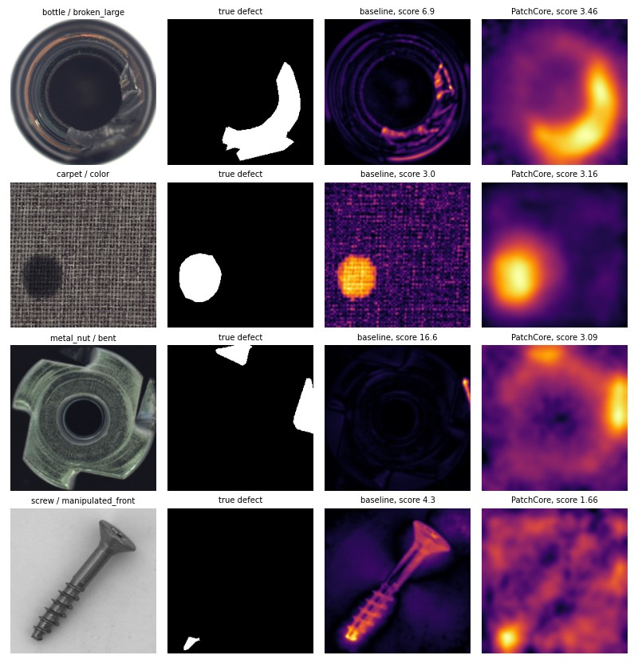

# industrial-defect-detection

Find surface defects (scratches, cracks, contamination, missing parts) in product images for automated visual inspection. A classical OpenCV baseline is compared with a deep anomaly model trained only on good parts, and the model runs as a CPU service with measured latency.



The first defect image of each category's test split (sorted order, not hand-picked), for the easy bottle and the baseline's three failures. Each map is scaled to its own range, so compare where it is bright, not how bright. PatchCore marks the defect in all four. The baseline finds the broken bottle rim and, surprisingly, the carpet's colour spot, but on carpet good images also reach high values somewhere, so its image score does not separate good from bad (AUROC 0.459). On the screw it lights up the whole part, because the screw lies at a different angle than in the average good image. Images from MVTec AD (CC BY-NC-SA 4.0); figure made by `notebooks/kaggle_heatmaps`.

## Results
Image-level, MVTec AD test split, per category. Each model is fit on that category's `train/good` images only. Baseline: one Kaggle CPU run, about 50 min for all 15 categories. Deep model: PatchCore-lite (pretrained Wide ResNet-50 features, 224 px, 10% coreset), one Kaggle run on a Tesla T4, about 50 min for all 15 categories (mostly building the memory bank).

| Category | Test images (good / defect) | Baseline AUROC | Baseline F1-max | F1 if every image is called defect | Deep model AUROC | Deep model F1-max |
| --- | --- | --- | --- | --- | --- | --- |
| bottle | 20 / 63 | 0.977 | 0.976 | 0.863 | 1.000 | 1.000 |
| cable | 58 / 92 | 0.596 | 0.763 | 0.760 | 0.996 | 0.978 |
| capsule | 23 / 109 | 0.729 | 0.911 | 0.905 | 0.972 | 0.977 |
| carpet | 28 / 89 | 0.459 | 0.864 | 0.864 | 0.989 | 0.977 |
| grid | 21 / 57 | 0.681 | 0.844 | 0.844 | 0.976 | 0.973 |
| hazelnut | 40 / 70 | 0.765 | 0.845 | 0.778 | 1.000 | 1.000 |
| leather | 32 / 92 | 0.786 | 0.852 | 0.852 | 1.000 | 1.000 |
| metal_nut | 22 / 93 | 0.587 | 0.894 | 0.894 | 1.000 | 1.000 |
| pill | 26 / 141 | 0.606 | 0.916 | 0.916 | 0.953 | 0.957 |
| screw | 41 / 119 | 0.454 | 0.853 | 0.853 | 0.964 | 0.941 |
| tile | 33 / 84 | 0.936 | 0.922 | 0.836 | 0.987 | 0.988 |
| toothbrush | 12 / 30 | 0.975 | 0.966 | 0.833 | 0.994 | 0.983 |
| transistor | 60 / 40 | 0.835 | 0.753 | 0.571 | 0.999 | 0.987 |
| wood | 19 / 60 | 0.946 | 0.950 | 0.863 | 0.989 | 0.975 |
| zipper | 32 / 119 | 0.775 | 0.918 | 0.881 | 0.995 | 0.987 |
| **mean** | | **0.740** | **0.882** | 0.834 | **0.988** | **0.982** |

Read F1 with care: most MVTec test sets have more defect than good images, so calling *every* image a defect already scores the F1 in the "every image is called defect" column. In 9 of 15 categories the baseline's best F1 is no better than that, which is why AUROC is the main metric here.

The baseline (per-pixel mean and spread of good images) works where every part sits in the same place and the surface is even: bottle, toothbrush, wood, tile reach AUROC 0.94-0.98. It fails where good parts vary in position or rotation (screw 0.454, metal_nut 0.587) and on carpet (0.459), worse than a coin flip, because a pixel there has no fixed "normal" value.

PatchCore-lite reaches AUROC 0.95 or higher in every category (mean 0.988) and fixes exactly the baseline's failures: screw 0.454 -> 0.964, carpet 0.459 -> 0.989, metal_nut 0.587 -> 1.000. It compares small patches by what they look like, not pixels by where they are, so a rotated screw or a random carpet texture still matches good patches. Its weakest categories are pill (0.953) and screw (0.964), where defects are small relative to the 8-pixel patch grid at 224 px.

### Latency
One 224 px image through the bottle model (image in, anomaly map out), batch size 1, on a laptop CPU: Intel Core i5-8365U (4 cores / 8 threads, 1.6 GHz), 200 runs after 10 warm-up runs. Image decoding and resizing are not included.

| Runtime | p50 | p95 |
| --- | --- | --- |
| ONNX Runtime 1.32 | 458 ms | 769 ms |
| PyTorch 2.15 (eager) | 618 ms | 891 ms |

ONNX Runtime is about 26% faster at the median. The median is stable (a second run gave 462 ms and 668 ms), the p95 is not (553 ms and 1000 ms in the second run): this is a laptop with other programs running, not a dedicated machine. At ~0.5 s per image this suits a slow inspection station, not a fast production line. Most of the time is probably the nearest-neighbour search, not the CNN: comparing 784 patches with 16,385 bank entries of 1,536 numbers is ~40 GFLOP, about twice the CNN's share. A smaller coreset is the first thing to try.

Reproduce: `python scripts/benchmark.py out/onnx/model.onnx` (model from `notebooks/kaggle_export`).

## Run it
```bash
pip install -e ".[dev]"
pytest
```

API (Docker, CPU, no PyTorch in the image). The model is not in the repo: get `model.onnx` + `model.onnx.data` from the `notebooks/kaggle_export` Kaggle job and put them in `out/onnx/`.
```bash
docker build -t idd .
docker run -p 8000:8000 -v $(pwd)/out/onnx:/models -e IDD_THRESHOLD=2.0 idd
curl -F "image=@bottle.png" localhost:8000/inspect
# {"score": 3.4628, "threshold": 2.0, "is_defect": true, "model_ms": 291.6}
```
Measured with the bottle model on the laptop (API run locally, not in Docker): MVTec `bottle/test/broken_large/000.png` scores 3.46 (defect), `bottle/test/good/000.png` scores 1.36 (good).

`IDD_THRESHOLD` is the score above which an image counts as a defect. It has to be set per product from good parts on the line; 2.0 here is only an example. Without it the API returns the score and `"is_defect": null`.

## How it works
Both models learn only from good parts. That matches the factory: defects are rare and every new kind looks different, so there are too few examples to train a classifier on.

- **Baseline** ([`idd/baseline.py`](src/idd/baseline.py)): grayscale 256 px, per-pixel mean and standard deviation over the good images. A test pixel's anomaly value is how many standard deviations it is from its mean (z-score, with Gaussian smoothing); the image score is the largest value.
- **PatchCore-lite** ([`idd/patchcore.py`](src/idd/patchcore.py)), after Roth et al. 2022:
  1. A Wide ResNet-50 pretrained on ImageNet (not fine-tuned) turns every 8x8 px patch of a 224 px image into a 1,536-number feature vector (layer2 + layer3, each averaged with its 3x3 neighbours).
  2. Fit: the features of all good training patches form a memory bank. A greedy k-center coreset keeps 10% of them, spread out so every good patch has a close neighbour in the bank.
  3. Score: each patch's distance to its nearest neighbour in the bank gives a 28x28 anomaly map; the image score is the largest patch distance.
  "Lite": no re-weighting of the image score by the neighbourhood density, which the paper adds.
- **Serving** ([`idd/export.py`](src/idd/export.py), [`idd/api.py`](src/idd/api.py)): CNN, pooling and memory bank go into one ONNX graph (the nearest-neighbour search written as a matrix product). The API decodes the image with OpenCV and runs the graph on ONNX Runtime, with no PyTorch in the Docker image.

## Limitations
- **One dataset, lab images.** MVTec AD has 60-400 well-lit, centred images per product. A real line brings new lighting, positions and cameras; the model must be refit on that line's good parts, and the numbers above do not transfer.
- **Image-level metrics only.** The table says whether an image is defective, not how well the map outlines the defect (pixel-level AUROC / PRO were not measured). The heatmaps above are four examples, not a measurement.
- **No threshold from data.** AUROC and F1-max do not fix a decision threshold, and F1-max picks the best one on the test set itself, so it is optimistic. In use, `IDD_THRESHOLD` must be set from good parts on the line (for example a high percentile of their scores) and checked against known defects.
- **Small defects.** One patch is 8x8 px of a 224 px image, so defects much smaller than that are blurred into their neighbours: pill (0.953) and screw (0.964) are the weakest categories.
- **Latency.** ~0.5 s per image on a 2019 laptop CPU, for one product with a 16,385-entry bank. Fine for a slow inspection station; a fast line needs a smaller bank, a smaller backbone or a GPU. Measured on one machine, with other programs running (p95 varied between runs).
- **One model per product.** Each category has its own memory bank and ONNX file (~200 MB); the API serves one at a time.
- **Licence.** MVTec AD is non-commercial (CC BY-NC-SA 4.0): treat models fit on it as non-commercial too.

## Data
[MVTec AD](https://www.mvtec.com/company/research/datasets/mvtec-ad) (Bergmann et al., 2019/2021), licence [CC BY-NC-SA 4.0](https://creativecommons.org/licenses/by-nc-sa/4.0/): non-commercial use only. Not stored in this repo.
